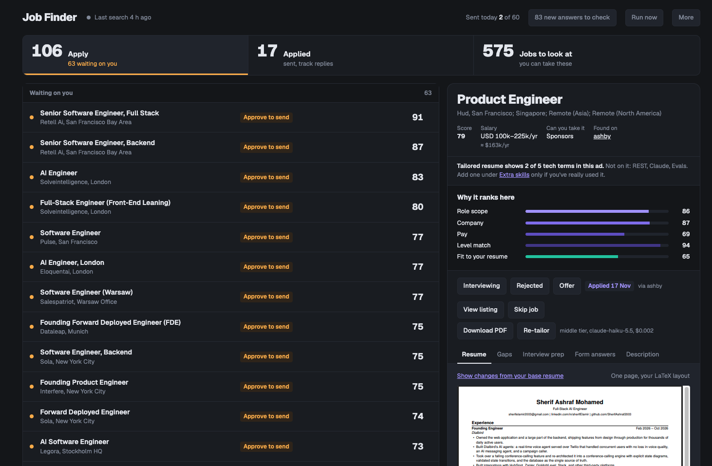

# Job Finder

A job-hunting agent that runs on your own machine. It finds software jobs, ranks them for you, tailors your resume to each one without inventing anything, and fills the application in your own Chrome. You approve what gets sent.

I built it for my own search: an engineer in Egypt applying to remote, Egypt-based and relocation roles. Out of the box it is set up for me; [Make it yours](#make-it-yours) lists the files to change for your own search.



## What it does

1. **Finds jobs** every few hours from company job boards (Greenhouse, Lever, Ashby, Workable), RemoteOK, We Work Remotely, Hacker News "Who is hiring", and optionally LinkedIn search results.
2. **Ranks them** with [Jev](https://typesafe.ai) on six things: role scope, company, pay, level, fit with your experience, and whether you can actually take the job from where you live. You set the weights; the ranking updates instantly.
3. **Tailors your resume** for every job above your cutoff: a one-page PDF built from your own LaTeX resume, reworded in the job's language. A claim check reverts anything your original resume doesn't support.
4. **Applies** through a Chrome extension that fills the form in a background tab. Dry run is on by default, the first 10 real submissions wait for your approval, and LinkedIn is never submitted automatically.

The dashboard has three tabs:

- **Apply**: everything waiting on you (approve, finish in Chrome, apply yourself) and what Chrome is working on.
- **Applied**: what you've sent, with interviewing, offer and rejected.
- **Jobs to look at**: ranked jobs the app hasn't acted on yet. Open one and press **Apply to this job** to tailor and queue it ahead of everything else.

## Setup (macOS)

You need Node 20+, Postgres 17, Tectonic (LaTeX), an [OpenRouter](https://openrouter.ai) key and a [TypeSafe](https://typesafe.ai) key.

```bash
brew install postgresql@17 tectonic && brew services start postgresql@17
createdb jobfinder && createdb jobfinder_test

npm install
cp .env.example .env    # fill in the keys and your Postgres user
npm run db:migrate      # migrates both the app and test databases
```

Keys in `.env`:

- `OPENROUTER_API_KEY`: resume tailoring (`OPENROUTER_TOP_MODEL`, `OPENROUTER_MID_MODEL`) and reading Hacker News posts (`OPENROUTER_CHEAP_MODEL`).
- `TYPESAFE_API_KEY`: Jev scoring. Without it jobs are found but not scored.
- `JEV_USD_PER_MTOK_INPUT`, `JEV_USD_PER_MTOK_OUTPUT`: Jev prices, used for the spend meter.

Keys stay in `.env` (git-ignored) and never reach the extension.

## Run

```bash
npm run dev      # dashboard at http://localhost:3000
npm run worker   # searches now, then every 4 hours (Settings → "Search every")
```

- `npm run worker -- --once` runs one search and exits; add `--skip-search` to only score and tailor existing jobs.
- `MAX_BOARDS=50 npm run worker -- --once` polls only 50 company boards, handy for a quick test.
- **Run now** in the dashboard queues a search; the worker picks it up within 30 seconds.

## How it works

**Finding.** Companies are seeded from YC's hiring list and `data/egypt-companies.json` by probing each ATS, plus every board link seen in other sources. Duplicate listings merge (same company and role), and the company's own ATS link wins. A free pre-filter drops non-software titles, internships, staff/principal/manager roles and listings asking for 8+ years.

**Ranking.** Jev scores each job once; the composite score comes from your weights, so changing them doesn't cost another call. Jobs you can't take (wrong country, no sponsorship) are kept out of the Apply flow.

**Tailoring.** Every takeable job at or above the cutoff (60) gets a full rewrite by the model in `.env` (Claude Haiku 5.5 by default). Then:

- **Nothing invented.** Every bullet must map to one of your real bullets. New numbers, names or tools revert to your original wording, and a second model checks for overstated claims. The dashboard shows anything that was reverted.
- **The job's spelling of your real skills** is allowed (Postgres for PostgreSQL), never a different product.
- **Extra skills** (Settings): skills you've really used that don't fit on your one-page resume. Up to 4 a job asks for can be added to a resume.
- **Always one page.** If a resume overflows, extra skills go first, then projects, then bullets from your longest role.
- Each job shows how many of the ad's tech terms your resume covers, and which are missing.
- Cover letters only when the listing asks for one. A gap report and interview prep are generated on demand.
- Files go to `data/out/<jobId>/` (git-ignored). Free models are never used for tailoring: your resume is personal data.

**Applying.** The local app decides everything (which job is next, what goes in each field, whether to submit); the extension only reads and fills the page.

- Fields are answered from your profile, then fixed rules (salary, sponsorship, work authorization, EEO), then your saved answers, then one model call for anything new. New answers are saved for you to review under **Saved answers**. A question your facts can't answer is never guessed: the job waits for you.
- **Dry run is on by default**: forms are filled but never submitted. Turn it off in **Sites & caps**.
- **Trust period:** the first 10 applications that would be submitted wait for you to press **Approve**.
- **LinkedIn is fill-only.** The extension stops on Easy Apply's review screen and leaves the tab for you.
- Sites other than Greenhouse, Lever, Ashby, Workable and LinkedIn show up as **Apply yourself**.

**Safety.** Editable caps: 15 LinkedIn forms a day, 3 a day per company board, 60 a day overall, 2 applications to the same company in 30 days. Random pauses between fields (0.4–1.5 s) and between jobs (90–240 s), one tab at a time. Three captchas in an hour, an "unusual activity" page or a logout pauses that site. **Pause everything** stops all applying.

LinkedIn's terms prohibit automated tools on its site. The LinkedIn collector and filler are optional; use them at your own risk.

## Chrome extension

1. Open `chrome://extensions`, turn on Developer mode, click **Load unpacked** and pick the `extension/` folder.
2. In the dashboard open **Sites & caps**, copy the extension token, and paste it into the extension (click its toolbar icon).
3. Open **Saved answers** and fill in your phone, city and notice period.
4. Keep `npm run dev` running. The extension checks for work every minute.

While a job is being filled Chrome shows a "started debugging this browser" bar: the extension uses it so dropdowns in a background tab behave as if it were focused. It goes away when the job is done.

## Budget

Hard cap of $10 a month (Settings). A full resume rewrite costs about $0.003 and a Jev score about $0.00015. Above 90% of the cap, tailoring falls back to reordering your bullets. Scoring and Hacker News extraction can use at most half of the cap, and at most 1/30 of that half per day. When a cap is hit, work stops and resumes in the next search with budget left.

## Make it yours

The app reads your resume from `resume.tex`, but some facts about me are written into the code. Change these before your first search:

| What | Where |
|---|---|
| Your resume (one page, same LaTeX layout) | `resume.tex`. The parser in `src/profile/parseLatex.ts` expects its sections; check the result with `npx tsx scripts/print-profile.ts`. |
| Years of experience, citizenship, location | `src/profile/parseLatex.ts` (`facts`) and `src/profile/types.ts` |
| Where you can work and relocate to | `src/scoring/state.ts` (`citizenship`, `relocation`) and the `canTake` question in `src/scoring/jev.ts` |
| Work authorization and sponsorship answers | `needsSponsorship` and `authorized` in `src/apply/rules.ts`, plus the hints in `src/app/answers/page.tsx` |
| Which titles to keep or drop | `INCLUDE`, `EXCLUDE` and `TOO_SENIOR` in `src/pipeline/prefilter.ts` |
| LinkedIn searches | `ROLES` in `src/app/api/ext/collect/route.ts` |
| Local companies to probe | `data/egypt-companies.json` (name and ATS slugs) |
| Weights, cutoff, caps, budget, extra skills | The dashboard's **Settings** and **Sites & caps** pages (no code) |

Jobs already scored keep their old scores, so change these before your first search, or start from a fresh database.

## Tests

```bash
npm test
```

Vitest runs against the `jobfinder_test` database. Check scripts for live sources live in `scripts/` (`fetch-board.ts <ats> <slug>`, `check-feeds.ts`, `score-one.ts <jobId...>`, `tailor-one.ts`).

## Stack

Next.js 15, Drizzle ORM on Postgres, Vitest, Tectonic for LaTeX, OpenRouter for tailoring, TypeSafe Jev for scoring, and a Manifest V3 Chrome extension.

## License

Apache 2.0
